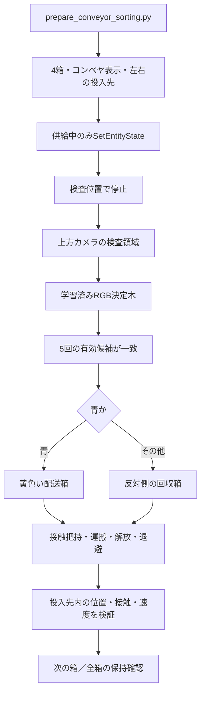

# 07 コンベヤ色選別：現在の提出デモ

更新日：2026-10-31（日本時間）。現在の提出物は青・赤・緑・青の4箱を処理する選別デモです。01〜06の単一箱配送の設計・検証は、その基礎と開発履歴として読みます。

## 起動と提出物の再生成

```bash
cd /home/ubuntu/final_pj/final_project_ros
DELIVERY_MODE=sorting ./run_demo.sh gui:=true
# 画面なしでも描画可能なDISPLAYが必要
DELIVERY_MODE=sorting ./run_demo.sh gui:=false
# 保存済み成功結果から提出物を生成（Gazeboは起動しない）
python3 tools/prepare_submission.py
```

run_demo.shの既定は単一箱のphysicalモードです。今回のデモにはsortingを明示します。出力を変える場合はoutput:="$PWD/artifacts/conveyor_sorting/trial_02.json"を付けます。提出生成が読む証跡はepisode.jsonと同名の動画・画像です。別名の試行が自動的に提出物へ採用されるわけではありません。

## データの流れとコード



|役割|実装|
|---|---|
|シーン生成|tools/prepare_conveyor_sorting.py|
|供給・色分類・行き先選択・繰り返し|conveyor_sorting.py（PhysicalDeliveryを継承）|
|物理把持・運搬の共通制御|physical_delivery.py|
|学習済み色分類器|learned_color.py、models/color_tree.yml|
|FK・IK・箱と指の幾何|physical_plan.py|
|起動|run_demo.sh→run_physical_demo.sh→physical_delivery.launch.py、sorting:=true|
|提出生成・検証|prepare_sorting_submission.py、check_physical_delivery.py|

ROSモジュールはros2_ws/src/final_project_ros/final_project_ros/にあります。従来の認識ノードも起動しますが、選別モードの行き先判定は/target_pointを使わず、選別ノード自身が上方カメラ画像を分類します。

## 供給と認識のパラメータ

|項目|値・扱い|
|---|---|
|箱と順番|parcel_00〜03、青・赤・緑・青。モデル名に色を含めない|
|生成元|prepare_conveyor_sorting.pyのcolors。生成したsorting_sequence.jsonを直接編集しても次回起動で戻る|
|検査位置|x=.205、y=-.025、供給時z=.071m。停止後は重力で落ち着く|
|供給|xを1更新につき最大.08×.05mずつ減らす。サービス応答待ちで平均速度は変わる|
|分類領域|既知の検査位置を上方カメラへ投影し、中心9×9画素|
|有効候補|75%以上が同色、背景以外、画像の経過時間.5秒以下|
|判定|同一フレームの二重投票を防止。有効候補が直近5回一致。無効フレームは追加せず、連続5枚の保証ではない|
|分類待機|停止後.5秒待機、10秒超で確信が得られなければ停止|
|配送箱中心|[.075,-.175]m|
|回収箱中心|[.075,.075]m|
|投入位置|各箱の中心からxを-.025、+.025mずらした2箇所|
|時間上限|1箱160秒、全体600秒。ROSタイマー内の検査であり、/clock停止に対する独立watchdogではない|

正解色は配置生成と事後照合に使い、認識や行き先決定には使いません。位置の観測・検証にはGazebo座標を使います。コンベヤは模擬搬送であり、停止後の物理把持と明確に分けます。

## 解放・退避と完了判定

単一箱制御の両指接触・持ち上げ・1秒保持・縁の高さ確保・運搬を再利用します。投入先はself.trayで切り替えます。

解放後は箱の床接触が.2秒以内、両指の最近の接触がそろわない状態（bilateral()がfalse）、指の部分開放角-.15radとの誤差が.05rad以内であることを確認します。実測関節値から指の最低点を求め、max(.012,.108-bottom)mの真上への退避を計画します。この区間だけは解放後の実測姿勢を指令始点にします。把持・運搬中は閉じ指令を引き継ぎます。全開前には全開形状で最低点z≥.1mを確認します。

箱ごとの配置判定は単一箱と同じ箱8頂点・床高さ・並進速度・角速度・最近の床接触です。回収箱のy座標を-.25m平行移動し、同じ幾何判定を使います。旧デモの「赤を動かさない」条件は適用せず、赤と緑も回収します。

全処理終了時は全箱の最終位置・姿勢・並進速度を再確認します。retained_at_endは過去の床接触確認を使った保持判定で、全箱の同時の床接触と角速度を再判定するものではありません。

## 実測・失敗と制約

最終版の通し実行1試行で4箱すべての色判定・投入が成功しました。記録されたwall_secondsは181.2秒、録画のシミュレーション時間は171.9秒です。選別のwall_secondsは選別ノード初期化から動画エンコードを含む保存処理後までで、ビルド・Gazebo起動は含みません。終了時の保持確認は各箱の過去の床接触確認と最終姿勢に基づき、全箱の同時の床接触や角速度を再測定したものではありません。この4箱は独立4試行の成功率ではなく、最終版の多数回反復による成功率は未評価です。ユニットテスト16件が通過しています。

- 成功証跡：[episode.json](../artifacts/conveyor_sorting/episode.json)、[動画](../artifacts/conveyor_sorting/episode.mp4)、[終了画像](../artifacts/conveyor_sorting/episode.png)、[ログ](../artifacts/conveyor_sorting/episode.log)。
- 解放時の関節追従停止：[release_interference.json](../artifacts/conveyor_sorting/release_interference.json)。実測姿勢からの退避を追加しました。
- 箱幅拡大時の持ち上げ失敗：[lift_slip.json](../artifacts/conveyor_sorting/lift_slip.json)。箱幅拡大、閉じ指令増加、動作時間の延長は最終版に採用していません。

既知の検査位置・色・照明・4cm箱4個、各投入先2個の専用シーンです。無限供給、容量管理、ベルト摩擦駆動、未知環境、実機は未検証です。次の評価ではコード版を固定し、複数回の通し実験と負の対照を新たに記録します。旧単一箱配送の4条件・開指対照を、新しい4箱デモの検証件数へ含めません。
