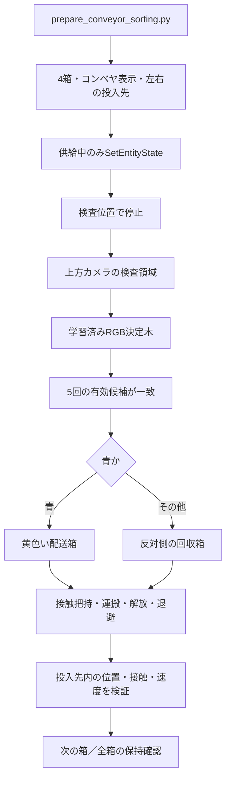
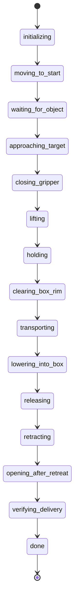

# CRANE+ 接触把持・コンベヤ色選別 開発・学習ガイド

このファイルは自動生成です。修正は各章のMarkdownへ行ってください。


<!-- source: README.md -->

# 開発・学習ドキュメント

更新日：2026-10-31（日本時間）。現在の提出デモはコンベヤからの4箱の色選別です。まず[07 コンベヤ色選別](07_CONVEYOR_SORTING.md)を参照してください。01〜06は単一箱物理配送の基礎設計・学習・開発履歴を扱い、選別モードとの差分は07にまとめています。コード・保存済みJSON・実行ログを根拠に記載しています。**実測事実、原因の解釈、未検証の改善案を区別**しています。

## 目的別の読み方

|目的|読む文書|
|---|---|
|現在の4箱選別を起動・理解する|[07 コンベヤ色選別](07_CONVEYOR_SORTING.md)|
|単一箱配送の全体像とコードの対応を理解する|[01 システム設計](01_SYSTEM_DESIGN.md)|
|把持学習を理解・再学習する|[02 学習の仕組み](02_GRASP_LEARNING.md)|
|失敗から調整の考え方を学ぶ|[03 開発・失敗記録](03_DEVELOPMENT_HISTORY.md)|
|数値を変える箇所と副作用を確認する|[04 パラメータ一覧](04_PARAMETER_REFERENCE.md)|
|基準結果を壊さず実験・評価する|[05 実験と再現](05_EXPERIMENT_RUNBOOK.md)|
|次に何をどう改善するか考える|[06 改善課題と演習](06_IMPROVEMENT_ROADMAP.md)|
|結果・失敗ログの実ファイルへ進む|[証拠ファイル索引](evidence/INDEX.md)|

現在の選別は07から読み、基礎は01→03→05の順に読み、再学習するときに02と04を参照すると、結果と実装のつながりを追いやすくなります。[実験記録テンプレート](EXPERIMENT_TEMPLATE.md)をコピーすると変更の比較を残せます。

## 現在の提出デモ

青・赤・緑・青を1箱ずつ供給し、画像分類後に青を配送箱、それ以外を反対側の回収箱へ投入します。最終版の通し実行1試行で4箱すべての色判定・投入に成功しました。実行時間は181.2秒、録画のシミュレーション時間は171.9秒です。この4箱は独立4試行の成功率ではなく、多数回反復による成功率は未評価です。終了時の保持確認は各箱の過去の床接触確認と最終姿勢に基づきます。ROS側テスト16件が通過しています。コンベヤは供給中のみ位置設定による模擬搬送で、停止後は物理把持です。

## 単一箱配送の保存済み検証（過去の基準）

青い4cm立方体1個を、接触・摩擦で把持し、持ち上げ、黄色の配送箱へ運搬し、解放・退避して箱内での静止を確認します。色分類と把持の補正値は学習済みです。配送のステートマシン・逆運動学・補間・到達確認は通常の制御コードです。

- MuJoCo把持単体：保存済み評価30件で30件成功。初期方策0件、開いた指の対照0件。
- 最終版Gazebo配送：標準配置と3条件、計4件で4件成功。開いた指の対照は把持で停止。
- ROS側回帰テスト：13件合格。MuJoCoの接触・解放テストは別に3件。

これらの条件は開発中にも繰り返し参照しています。「CEMの学習seedと異なる」という意味での未学習条件であり、全開発工程から隔離した未知テストセットではありません。4/4を任意配置での成功率100%と解釈しないでください。

## 記録の扱い

`../FINAL_REPORT.md`と提出用PDFは短い成果説明です。本ディレクトリは開発・学習用の詳細資料です。選別証跡がある場合、`tools/prepare_submission.py`は`tools/prepare_sorting_submission.py`を通じて`FINAL_REPORT.md`、提出用PDFと動画を再生成します。この詳細資料は上書きしません。

証拠索引は`tools/document_experiments.py`で更新できます。参照用のコード・設定・結果は`evidence/reference_snapshot/`に保存し、SHA-256で照合できるようにしています。reference_snapshotは旧単一箱版の控えです。現在版のソースは提出ZIPを参照します。スナップショットは主要ソースと記録の控えであり、ROSや全依存ライブラリを含むコンテナイメージではありません。


<!-- source: 07_CONVEYOR_SORTING.md -->

# 07 コンベヤ色選別：現在の提出デモ

更新日：2026-10-31（日本時間）。現在の提出物は青・赤・緑・青の4箱を処理する選別デモです。01〜06の単一箱配送の設計・検証は、その基礎と開発履歴として読みます。

## 起動と提出物の再生成

```bash
cd /home/ubuntu/final_pj/final_project_ros
DELIVERY_MODE=sorting ./run_demo.sh gui:=true
# 画面なしでも描画可能なDISPLAYが必要
DELIVERY_MODE=sorting ./run_demo.sh gui:=false
# 保存済み成功結果から提出物を生成（Gazeboは起動しない）
python3 tools/prepare_submission.py
```

run_demo.shの既定は単一箱のphysicalモードです。今回のデモにはsortingを明示します。出力を変える場合はoutput:="$PWD/artifacts/conveyor_sorting/trial_02.json"を付けます。提出生成が読む証跡はepisode.jsonと同名の動画・画像です。別名の試行が自動的に提出物へ採用されるわけではありません。

## データの流れとコード



|役割|実装|
|---|---|
|シーン生成|tools/prepare_conveyor_sorting.py|
|供給・色分類・行き先選択・繰り返し|conveyor_sorting.py（PhysicalDeliveryを継承）|
|物理把持・運搬の共通制御|physical_delivery.py|
|学習済み色分類器|learned_color.py、models/color_tree.yml|
|FK・IK・箱と指の幾何|physical_plan.py|
|起動|run_demo.sh→run_physical_demo.sh→physical_delivery.launch.py、sorting:=true|
|提出生成・検証|prepare_sorting_submission.py、check_physical_delivery.py|

ROSモジュールはros2_ws/src/final_project_ros/final_project_ros/にあります。従来の認識ノードも起動しますが、選別モードの行き先判定は/target_pointを使わず、選別ノード自身が上方カメラ画像を分類します。

## 供給と認識のパラメータ

|項目|値・扱い|
|---|---|
|箱と順番|parcel_00〜03、青・赤・緑・青。モデル名に色を含めない|
|生成元|prepare_conveyor_sorting.pyのcolors。生成したsorting_sequence.jsonを直接編集しても次回起動で戻る|
|検査位置|x=.205、y=-.025、供給時z=.071m。停止後は重力で落ち着く|
|供給|xを1更新につき最大.08×.05mずつ減らす。サービス応答待ちで平均速度は変わる|
|分類領域|既知の検査位置を上方カメラへ投影し、中心9×9画素|
|有効候補|75%以上が同色、背景以外、画像の経過時間.5秒以下|
|判定|同一フレームの二重投票を防止。有効候補が直近5回一致。無効フレームは追加せず、連続5枚の保証ではない|
|分類待機|停止後.5秒待機、10秒超で確信が得られなければ停止|
|配送箱中心|[.075,-.175]m|
|回収箱中心|[.075,.075]m|
|投入位置|各箱の中心からxを-.025、+.025mずらした2箇所|
|時間上限|1箱160秒、全体600秒。ROSタイマー内の検査であり、/clock停止に対する独立watchdogではない|

正解色は配置生成と事後照合に使い、認識や行き先決定には使いません。位置の観測・検証にはGazebo座標を使います。コンベヤは模擬搬送であり、停止後の物理把持と明確に分けます。

## 解放・退避と完了判定

単一箱制御の両指接触・持ち上げ・1秒保持・縁の高さ確保・運搬を再利用します。投入先はself.trayで切り替えます。

解放後は箱の床接触が.2秒以内、両指の最近の接触がそろわない状態（bilateral()がfalse）、指の部分開放角-.15radとの誤差が.05rad以内であることを確認します。実測関節値から指の最低点を求め、max(.012,.108-bottom)mの真上への退避を計画します。この区間だけは解放後の実測姿勢を指令始点にします。把持・運搬中は閉じ指令を引き継ぎます。全開前には全開形状で最低点z≥.1mを確認します。

箱ごとの配置判定は単一箱と同じ箱8頂点・床高さ・並進速度・角速度・最近の床接触です。回収箱のy座標を-.25m平行移動し、同じ幾何判定を使います。旧デモの「赤を動かさない」条件は適用せず、赤と緑も回収します。

全処理終了時は全箱の最終位置・姿勢・並進速度を再確認します。retained_at_endは過去の床接触確認を使った保持判定で、全箱の同時の床接触と角速度を再判定するものではありません。

## 実測・失敗と制約

最終版の通し実行1試行で4箱すべての色判定・投入が成功しました。記録されたwall_secondsは181.2秒、録画のシミュレーション時間は171.9秒です。選別のwall_secondsは選別ノード初期化から動画エンコードを含む保存処理後までで、ビルド・Gazebo起動は含みません。終了時の保持確認は各箱の過去の床接触確認と最終姿勢に基づき、全箱の同時の床接触や角速度を再測定したものではありません。この4箱は独立4試行の成功率ではなく、最終版の多数回反復による成功率は未評価です。ユニットテスト16件が通過しています。

- 成功証跡：[episode.json](../artifacts/conveyor_sorting/episode.json)、[動画](../artifacts/conveyor_sorting/episode.mp4)、[終了画像](../artifacts/conveyor_sorting/episode.png)、[ログ](../artifacts/conveyor_sorting/episode.log)。
- 解放時の関節追従停止：[release_interference.json](../artifacts/conveyor_sorting/release_interference.json)。実測姿勢からの退避を追加しました。
- 箱幅拡大時の持ち上げ失敗：[lift_slip.json](../artifacts/conveyor_sorting/lift_slip.json)。箱幅拡大、閉じ指令増加、動作時間の延長は最終版に採用していません。

既知の検査位置・色・照明・4cm箱4個、各投入先2個の専用シーンです。無限供給、容量管理、ベルト摩擦駆動、未知環境、実機は未検証です。次の評価ではコード版を固定し、複数回の通し実験と負の対照を新たに記録します。旧単一箱配送の4条件・開指対照を、新しい4箱デモの検証件数へ含めません。


<!-- source: 01_SYSTEM_DESIGN.md -->

# 01 システム設計とコードの読み方

以下は単一箱物理配送の共通基盤です。現在の4箱選別は[07](07_CONVEYOR_SORTING.md)を参照してください。選別では停止位置の画像分類で行き先を決め、赤も回収し、供給中のみ位置設定を使います。

## 1. 最初の問題から完成形へ

旧デモは静的な対象モデルを手先へ追従させる方式で、見た目の搬送と実際の保持が一致しませんでした。色だけを学習しており、把持動作は学習していませんでした。今回、学習用MuJoCo環境と、力・接触を使うGazebo配送モードを追加しました。旧方式は比較・参照用に残しています。

|段階|役割|主な実装|
|---|---|---|
|学習用モデルの準備|URDFを読み、指の凹形状を凸分割|`physics_grasp/prepare_model.py`, `build_scene.py`|
|把持方策の学習|8変数をCEMで探索、保持の成否を評価|`physics_grasp/experiment.py`|
|Gazeboモデル生成|動的な箱、配送箱、接触センサー、effort設定|`tools/prepare_physical_delivery.py`|
|色の認識|RGB決定木→マスク→輪郭中心|`gazebo_delivery_demo.py`, `learned_color.py`|
|配送制御|接近、把持、運搬、解放、完了確認|`physical_delivery.py`|
|運動学と幾何判定|FK/IK、箱8頂点、指の最低点|`physical_plan.py`|
|滑らかな軌道|速度・加速度を制限する5次補間|`motion_profile.py`|
|検証・保存|試験、失敗終了、集計、提出物生成|`tools/*physical*.py`|

以下、ROSモジュールの場所は`../ros2_ws/src/final_project_ros/final_project_ros/`です。

## 2. データの流れ

```mermaid
flowchart TD
    URDF[CRANE+ URDF] --> MJ[MuJoCo 接触物理モデル]
    MJ --> CEM[CEM 把持方策探索]
    CEM --> POLICY[physics_grasp/results/policy.json]
    POLICY --> PREP[prepare_physical_delivery.py]
    URDF --> PREP
    PREP --> GZ[Gazebo ODE + effort制御]
    GZ --> IMG[上方カメラ画像]
    IMG --> COLOR[RGB決定木・輪郭中心]
    COLOR --> DET[/target_point]
    GZ --> OBS[モデル位置・関節値・接触]
    OBS --> CTRL[physical_delivery.py]
    DET --> CTRL
    CTRL --> IK[physical_plan.py]
    IK --> PROFILE[motion_profile.py]
    PROFILE --> GZ
    CTRL --> EVIDENCE[JSON・動画・画像]
```

画像はピック開始の確認に使い、3次元座標はGazeboから読みます。深度推定、画像からの直接関節制御、実機カメラによる一般的な物体姿勢推定は実装していません。

## 3. 起動経路と生成物

`run_demo.sh`→`run_physical_demo.sh`→環境source→モデル生成→colcon build→`physical_delivery.launch.py`の順です。モデル生成は毎回行うため、生成済みURDFやYAMLを直接編集すると次の起動で戻ります。

生成元：`tools/prepare_physical_delivery.py`。

|生成先（ROSパッケージ内）|内容|
|---|---|
|`worlds/physical_delivery.world`|箱、配送箱、照明、カメラ、接触センサー|
|`config/physical_crane.urdf`|既存CRANE+から生成したeffort版|
|`config/physical_controllers.yaml`|関節軌道制御器とゲイン|
|`config/gripper_collision_vertices.npz`|STLから抽出した指の頂点|
|`config/physical_scene.json`|seed、質量、摩擦、初期位置|
|`models/learned_grasp_policy.json`|MuJoCoの保存済み方策のコピー|

launchはGazeboとrobot_state_publisherを起動し、ロボット生成後にjoint_state→arm→handの順でコントローラを起動します。その後に認識・配送ノードを起動します。配送ノードが終了するとGazeboも終了します。起動シーケンスはプロセス終了イベントでつないでおり、各spawnerの終了コードを厳密に分岐する構成ではありません。起動失敗の調査ではログも確認してください。

通常モードは`DELIVERY_MODE=physical`、旧方式は`legacy`です。物理モードではMoveIt `/compute_ik`を使わず、専用の数値IKを使います。

## 4. ROSトピック

|トピック|型|用途|
|---|---|---|
|`/camera/color/image_raw`|sensor_msgs/Image|上方カメラ→色認識|
|`/target_point`|geometry_msgs/PointStamped|画像のピクセル中心。メートルではない|
|`/gazebo/model_states`|gazebo_msgs/ModelStates|対象位置・姿勢・速度の観測|
|`/joint_states`|sensor_msgs/JointState|実測関節値|
|`/grasp/contacts`|gazebo_msgs/ContactsState|青い箱と両指・配送箱床との接触|
|`/crane_plus_arm_controller/joint_trajectory`|trajectory_msgs/JointTrajectory|4関節の指令|
|`/crane_plus_gripper_controller/joint_trajectory`|同上|手指1関節の指令|
|`/demo_camera/color/image_raw`|sensor_msgs/Image|斜めからの記録用カメラ|
|`/task_state`|std_msgs/String|状態の通知|

制御周期の指定は20ms、接触センサーは100Hz、controller_managerは500Hzです。Pythonノードや描画の処理遅延があるため、指定周期どおりの実測サンプリングは保証されません。

## 5. 座標と寸法

単位はm、rad、s、kg、Nmです。`BASE=[0.1,-0.05,0.05]`はロボット基準のワールド位置です。`object_position()-BASE`で専用運動学の基準へ変換します。ベース姿勢の回転は扱わず、平行移動だけを仮定しています。

|対象|ワールド座標・寸法|
|---|---|
|青い箱の初期中心|`[0.205,-0.025,0.071]`、一辺0.04|
|学習環境内の基準XY|`[0.105,0.025]`（GazeboのBASE差し引き後に対応）|
|テーブル上面|z=0.05|
|配送箱中心XY|`TRAY=[0.075,-0.175]`|
|配送箱の床上面|z=0.06|
|配送箱の壁上端|z=0.095|
|配送箱の内側半幅|0.07|
|赤い箱の初期中心|`[0.31,0.055,0.071]`|

箱は重力で少し沈み、初期中心zは約0.0698で落ち着きます。初期生成位置0.071と、配送開始時の観測値を混同しないでください。

上方カメラは位置`[0.55,0.15,1.4]`、画像640×480、水平画角1.3962634radです。制御側はこの値を直接使って投影します。`fx=fy=640/(2*tan(fov/2))`、`depth=1.4-z`、`u=320-fx*(y-.15)/depth`、`v=240-fy*(x-.55)/depth`です。検出と投影の差18pixel未満で検出時刻を更新し、1秒以内の検出を開始条件にします。カメラを変える場合はワールドと`on_detection()`の両方を更新する必要があります。

## 6. ステートマシン



いずれの段階でも例外や判定失敗は`error`へ進み記録を保存します。

|状態|実行内容・次へ進む条件|
|---|---|
|initializing|関節・対象モデル・軌道購読者を待ち、把持計画を計算|
|moving_to_start|開いた指で学習時の持ち上げ姿勢へ移動|
|waiting_for_object|最近1秒以内の画像対応。10秒超で検出失敗|
|approaching_target|学習した補正位置・手首姿勢へ接近|
|closing_gripper|閉じ指令を送り、軌道終了後に両指接触を確認|
|lifting|持ち上げ後、両指接触かつ箱中心がBASEより0.065以上|
|holding|1秒保持。この間も両指接触を確認|
|clearing_box_rim|箱中心を少なくともworld z=0.16へ狙い、手首pitch=2.2で余裕を作る。完了時に箱8頂点の最低z≥0.11|
|transporting|主に第1関節のyawを回す。速度0.5・加速度0.8に制限|
|lowering_into_box|観測した把持オフセットを使い、中心world z=0.105、pitch=2.8へ下降|
|releasing|中心XYの誤差≤0.045を確認し、指を-0.15radまで開く|
|retracting|指の最低点から必要上昇量を計算し、姿勢を保って上昇|
|opening_after_retreat|全開を仮定した指最低点world z≥0.1を確認し、-0.65radへ全開|
|verifying_delivery|1.5秒待った後、箱内位置・床接触・速度・赤い物体を確認|

`ready()`は指令終了後0.25秒以上経ち、4つのアーム関節の最大誤差が0.10rad未満なら通ります。終端時刻+4秒を過ぎても未到達なら停止します。旧制御の連続3サンプル判定とは異なり、物理配送では1回の判定です。指の目標角への到達は要求しません。物体に当たった指が目標より手前で止まることは把持中の正常な状態だからです。

## 7. 把持と運搬を分けて考える

学習した把持は、最初に箱を挟むまでの補正です。配送ではさらに、配送箱の壁を越える高さ、運搬中の保持、解放時の干渉を扱う必要があります。把持単体30/30成功でも配送完成にはならなかったのは、この追加条件があったためです。

運搬の計画は、実測した箱位置と手首姿勢から`offset=R.T@(box-BASE-wrist)`を計算します。配置IKでは予測箱位置`wrist(q)+R(q)@offset`が配送目標へ来るように解きます。このオフセットは**到達目標の計算だけ**に使います。物理エンジン内の箱の位置を書き換えたり、固定拘束で貼り付けたりはしません。滑り・変形・把持のずれを完全に補償する制御でもありません。

## 8. 接触判定と完了判定の正確な意味

両指の接触は、それぞれ最後に検出した時刻が現在から0.2秒以内かで判断します。2つの接触が同一物理ステップで存在することや、最小の接触力を満たすことは要求していません。ノイズに対する猶予を与える一方、短い離脱を見逃す余地があります。

運搬中の落下判定は箱中心world z<0.105、または開始0.3秒後以降に両指接触が失われることです。箱の8頂点の縁クリアランスは運搬**開始前**に確認し、運搬中に毎回再確認してはいません。

最終判定は次の条件です。

- 箱の8頂点のXY範囲が配送箱中心±0.071以内（内側半幅0.07に1mmの許容）。
- 箱底面の最低zが0.057より大きく0.063未満、最高zが0.115未満。
- 並進速度<0.02m/s、角速度≤0.1rad/s。
- 配送箱床との接触履歴が0.2秒以内。
- `bilateral()`がfalse、赤い物体の開始時からの3次元変位≤0.005m。

「両指で保持していない」判定であって、「どちらの指にも一切触れていない」ことを直接要求するコードではありません。退避形状確認との組み合わせで分離を狙っています。また1.5秒間ずっと安定したことを統計するのではなく、待機後の1回の判定です。

## 9. 指令の連続性

区間の始点を毎回実測角にすると、把持で物体に阻まれた指の位置まで指令が戻り、保持トルクを生む誤差が消えます。現在は、初回以外はアームを`self.goal`、指を`self.hand_setpoint`から補間します。実測値は到達確認と運動学へ使い、指令の継ぎ目は前の目標に接続します。

これは大きな追従誤差がある状態でも無条件に続ける設計ではありません。`ready()`の誤差制限で停止させます。ただし指令の連続性は、実測速度・トルクの連続性そのものを保証しません。

## 10. 今後の実装時に守りたい境界

- 実際の接触把持を評価する間は、対象位置の強制更新や固定拘束を導入しない。
- 関節の到達と、対象を保持できたことを別に判定する。
- 学習用のモデル、Gazebo用のモデル、成功条件、使用した方策を一緒に記録する。
- `error`はシミュレーション上の停止・終了です。実機の保護停止や非常停止として使えるものではありません。
- ソースの物理設定を変えた場合は、学習方策も別条件で得たものとして扱う。


<!-- source: 02_GRASP_LEARNING.md -->

# 02 把持学習の仕組みと再学習の考え方

この把持学習は現在の[4箱選別](07_CONVEYOR_SORTING.md)でも再利用しています。記載する把持単体の評価件数は、選別の通し検証件数とは別です。

## 1. 今回の学習対象

方策は8個の実数からなる低次元のパラメータです。ニューラルネットワーク、PPO、ACT、画像からのend-to-end制御ではありません。物体位置を観測し、学習した補正を使って把持姿勢を作り、通常のIKと補間で動かします。

少ない変数から始めると、学習の失敗を物理モデルの問題と区別しやすく、CPUで多数試行できます。この方式で把持単体を成立させ、その値をGazeboへ渡しました。Gazeboでは追加の方策学習はしていません。

## 2. 方策の値・探索範囲

正確な値は`../physics_grasp/results/policy.json`です。下表は読みやすく丸めています。

|名前|意味|探索下限|探索上限|保存済み最終値|
|---|---|---:|---:|---:|
|radial_offset_m|対象の方位方向への手首XY補正|-.02|.02|-.00490425|
|lateral_offset_m|対象の方位に直交するXY補正|-.04|.02|-.01152912|
|wrist_height_m|学習環境の手首高さ|.125|.16|.15666949|
|pitch_rad|手首のpitch|2.7|3.5|3.28660229|
|close_rad|閉じ指令の関節角|-.1|.66|.42162492|
|move_s|接近の希望時間|.7|2.2|.84337666|
|close_s|閉じる希望時間|.3|1.2|.30127578|
|lift_s|持ち上げの希望時間|.7|2.2|.87013357|

補正2軸はワールドX/Yそのものではありません。対象の方位`yaw=atan2(y,x)`で回転した局所方向です。手首XYは`object_xy+Rz(yaw)@[dr,dy]`になります。

**Gazeboへの反映範囲に注意：** `grasp_plan()`は8値を読み込みますが、配送ノードが時間として使うのは`move_s`だけで、それも`max(1.0, move_s)`を最短時間にします。`close_s`と`lift_s`は計画辞書へ保存するものの、Gazebo配送の該当区間は最短1.5秒の固定指定です。最終のmove_sは1秒未満なので、この方策ではGazebo上の接近時間も最短値に丸められます。学習した8値がGazeboで全て同じ意味で最適化されているわけではありません。

## 3. 方策から姿勢を作る

学習時は把持手首位置とpitchをIKへ渡します。持ち上げは同じpitchで真上へ動かすだけでは、CRANE+の第4関節の限界に当たりました。そこでpitchを0.65rad減らし、局所把持点`[0,.015,.11]`の回転差を手首位置へ補正し、箱を上へ約0.065m持ち上げる計画にしました。

```text
lift_pitch = pick_pitch - 0.65
lift_wrist = pick_wrist + (R_pick - R_lift) @ local_grip + [0,0,0.065]
```

局所把持点は設計した近似値です。実物体の接触点を推定して学習したものではありません。Gazeboの`grasp_plan()`では観測した対象zと学習時の0.02mとの差も手首高さに加えます。

## 4. CEMの処理

実装は`experiment.py:train()`です。

1. 平均`mean`と標準偏差`std`を初期化する。
2. 正規分布からpopulation個の候補を生成し、探索範囲へclipする。
3. 候補0へ現在の最良方策を入れ、良い解を保持する。
4. 各候補を配置seed 0,1,2で実行する。学習中の質量は0.03kg、摩擦は1.0。
5. 3試行の平均報酬で候補を順位付けする。
6. 上位`max(4,population//4)`個をeliteにする。
7. 平均を`0.25*旧mean+0.75*elite_mean`で更新する。
8. 標準偏差を`max(0.7*elite_std+0.3*旧std, SCALE*0.06)`で更新する。
9. 最良方策と世代履歴を保存する。

初期値は`[0,-.015,.145,pi,.6,1.4,.7,1.4]`、初期標準偏差は`[.009,.009,.012,.18,.22,.3,.2,.3]`です。`--resume`時は保存済み方策を平均とし、標準偏差を`SCALE*0.3`にします。**前回の平均・分散や乱数発生器の状態を復元する完全なcheckpoint resumeではありません。** 前回の世代履歴も新しい`training.json`で上書きされます。

既定のpopulation=24ならelite=6、1世代に72回の物理ロールアウトです。15世代なら探索本体は1080回です。これに開始時の初期方策3回、評価90回、動画用1回が加わります。IKに失敗した試行は物理ステップに進まず早期終了します。最終の保存履歴は、成功方策を中心に追加探索した8世代分です。

populationが4未満の場合の品質や入力検証は整えていません。実験では24以上を使うことを勧めます。これは今回のコードに対する運用上の目安であり、広範なpopulation比較の結果ではありません。

## 5. 報酬と成功条件

```text
reward = 8*hold_fraction
       + 30*clip(mean_hold_height - .02, -.02, .08)
       + 3*success
       - .08*simulation_duration
       - .05*roughness
       + .5*bilateral_contact_fraction
```

`hold_fraction`は、保持中に「箱中心z>.065かつ両指接触」を満たした観測の割合です。保持は1秒、判定は物理5stepごと（0.002×5=0.01秒）です。成功はhold_fraction≥.95かつ終了時中心z>.065です。

`bilateral_contact_fraction`は保持中の両指接触割合です。`roughness`は記録した4関節速度の隣接差の二乗平均で、時間刻みで割った物理的な加速度ではありません。`energy_proxy_j`は絶対値の関節機械パワーを積算した参考量で、電力消費・回生を含む消費エネルギーではなく、報酬にも使っていません。

IKの重み付き残差ノルムが.004を超えた場合は`-5-100*error`で終了します。位置誤差だけの4mm閾値ではなく、pitch誤差へ0.05を掛けた成分も含む値です。

この報酬には箱の姿勢、接触力の上下限、テーブルへの指の押し付け、自己衝突、運搬や配送成功は直接入っていません。物理設定が誤っていると、その誤りを利用した解を見つける可能性があります。開いた指との比較と、把持後の解放テストを設けた理由です。

## 6. 物理モデルの工夫

|設定|MuJoCo学習環境|
|---|---|
|物理刻み|0.002s|
|積分器|implicitfast|
|接触円錐|elliptic|
|反復回数|80|
|接触次元|condim=4|
|基準摩擦|1.0, 0.01, 0.001|
|接触応答|solref=.006 1、solimp=.95 .99 .001|
|関節減衰・摩擦|damping=.3、frictionloss=.02|
|位置アクチュエータ|kp=35、kv=1.5、力制限±1.5Nm|
|指令速度・加速度|1.5rad/s、4rad/s²|

`build_scene.py`で、固定指を含むLink4と可動Handの衝突メッシュをCoACDで凸分割しました。保存済みの分割数は49と40です。単一の凸包にして指の隙間まで埋まることを避けるためです。閾値0.04、resolution=1000、mcts_iterations=100、seed=0です。thresholdはこのアルゴリズムの近似設定であり、形状誤差が4cm以内という意味ではありません。

既存の`part*.obj`があればキャッシュを使います。元メッシュや分割設定を変えても、自動的には作り直しません。再分割したい場合は対象のキャッシュフォルダを別名へ退避してから生成し直します。

MuJoCoでは凸分割した形状、Gazeboでは元URDFの三角形メッシュを使います。同じロボット由来でも接触形状とソルバは一致しません。sim-to-sim転用の成功は、実機への転用成功を意味しません。

## 7. 初期状態と評価の設計

ロールアウトはリセット時にだけ箱の位置・姿勢と初期関節角を書き込みます。学習ではアームを持ち上げ姿勢から開始し、初期姿勢へ移動する工程を評価しません。Gazeboでは実際の関節状態からその姿勢へ動くため、起動時の条件も異なります。

箱位置は学習環境でx=.105±.008、y=.025±.015、初期z=.021、初期向きは固定です。`build_scene.py`内の箱初期位置`.15,.05,.02`はロールアウトのresetで上書きされ、学習分布ではありません。

評価はseed 1000〜1029です。摩擦はindex mod 3で.7/1.0/1.3、質量はfloor(index/3) mod 3で.02/.03/.04へ振ります。30件で全ての組み合わせと位置を網羅する設計ではありません。`model.geom_friction[:,0]`を変更するため、箱だけでなく全geomの第1摩擦成分を変えます。

最終評価の保存結果は、学習方策30/30、初期方策0/30、開いた指0/30です。動画はseed1000、摩擦.7、質量.02の試行です。成功例だけを探索して動画へ採用するフィルタはありません。

## 8. 履歴を読む際の注意

|保存先|世代数|最終best_reward|学習方策の評価|
|---|---:|---:|---:|
|attempt1_results|15|0.124636|0/30|
|attempt2_results|16|-0.116270|0/30|
|attempt3_results|15|13.712930|30/30|
|results|8|13.546499|30/30|

途中で物理設定や軌道制限・時間ペナルティの実装も変わっています。13.71から13.55への減少を「学習性能が劣化した」と比較することはできません。最終版は指令制限を入れた成功方策です。

初期方策0/30という比較は、このパラメータ初期値との比較です。熟練者が最適化した全ての非学習把持法より優れることは示していません。開発中に評価条件を参照しているため、独立な最終テストを行うには新たなseed集合と物理条件を確保してください。


<!-- source: 03_DEVELOPMENT_HISTORY.md -->

# 03 開発過程・失敗からの学び

以下は単一箱配送までの開発履歴です。2026-10-27の選別追加・解放後退避の修正・保存した失敗は[07](07_CONVEYOR_SORTING.md)を参照してください。

この文書は保存済み記録と開発時の観測を対応付けたものです。全ての試行のソース版が保存されているわけではなく、複数設定を同時に変更した段階もあります。改善後に成功しても、各変更の単独の因果効果まで実証したとは扱いません。古い試行の厳密な再実行には、当時のソース・依存環境も必要です。

## 1. 見かけの把持から接触把持へ

**出発点：** 旧ワールドの青い物体はstaticで、表示用形状のみでした。制御側は対象の位置を手先に追従させていました。物体が指から離れていても配送できるため、把持の学習や保持力の検証には使えませんでした。

**変更：** 動的な4cm箱、質量と慣性、衝突形状、摩擦、重力を与えました。MuJoCoはリセット時だけ初期状態を書き込み、Gazeboの配送ノードは対象モデルを読むだけにしました。

**学び：** 映像の位置関係だけでなく、対象が自由物体であること、保持中の接触、開放後に落下することを確認する必要があります。[MuJoCoテスト](../physics_grasp/test_physics.py)では、固定拘束・mocap・外力の有無、開いた指では持ち上がらないこと、保持後に開くと落ちることを確認します。

## 2. 到達できない目標は学習でも解決できない

最初は元の対象に近い位置から上方把持を狙いましたが、姿勢と持ち上げ高さの組み合わせが4自由度アームの可動範囲へ収まりませんでした。大きな負報酬の多くがIK失敗で、接触を試す前に終了していました。

対象の学習基準位置をロボット近くの`[.105,.025]`へ変えました。同じpitchで上へ動くと第4関節が限界へ当たるため、持ち上げ時にpitchを0.65rad減らし、把持点の回転分だけ手首を補正する計画にしました。

**学び：** 「学習の世代数を増やす」前に、候補が物理ステップまで進んだ割合とIK残差を確認します。解が存在しない領域へ探索範囲を広げても、学習時間が増えるだけです。最初の箱配置は完成シーンの到達性を優先したもので、元のコンベヤ配置を維持したまま解決したわけではありません。

## 3. 指の隙間を衝突形状に残す

表示メッシュと物理衝突形状は別です。凹形状の指を単一凸包で近似すると、物体を入れたい隙間まで埋まる場合があります。MuJoCo用にはLink4とHandをCoACDで複数の凸形状へ分割しました。表示は元メッシュ、接触は分割形状を使います。

**調整点：** threshold=.04、resolution=1000、mcts_iterations=100、seed=0。保存済み分割は49/40個でした。細かくするほど正確とは限らず、計算量と接触点の増加が安定性に影響します。今回は分割精度の網羅的比較はしていません。

**学び：** 「画像では掴めそう」でも、物理エンジンが見ている形状が違うと接触しません。衝突形状を表示して確認することが重要です。

## 4. 床に当たる、箱を押す、学習が進まない

初期の試行は箱を押し出し、保持評価0/30でした。指先が床へ当たり、指令した手首位置まで下降できない動きも観測しました。把持高さや持ち上げ姿勢を調整しましたが、これだけでは成立しませんでした。

この段階の例は[attempt1評価](../physics_grasp/attempt1_results/evaluation.json)と[attempt2評価](../physics_grasp/attempt2_results/evaluation.json)に残っています。高い報酬が出ないときは、物体が全く動かないのか、押すだけなのか、途中まで持ち上がるのかで次の修正が変わります。報酬の1個の数値だけを見ると区別できません。

## 5. 開閉方向の取り違え

メッシュ頂点を関節座標へ変換し、指令角と実測角・画像を比較した結果、このモデルは**正方向で閉じ、負方向で開く**ことが分かりました。旧コードの「open=.5、closed=-.5236」という命名に従っていたため、物理把持では逆の動作になっていました。

現在は全開`-.65`、学習した閉じ指令約`.4216`です。方向を修正した探索では、学習用3配置で保持成功が現れ、保存済み評価は30/30になりました。[attempt3評価](../physics_grasp/attempt3_results/evaluation.json)を参照してください。

**学び：** 変数名や過去のデモでの見た目を物理的な開閉方向の根拠にしないこと。関節軸、指の形状、指令・実測角を一緒に確認します。学習アルゴリズムは、全ての候補に共通する実装ミスを自動的に直すものではありません。

## 6. 速度・加速度制限を入れて再調整

最初の成功方策は速く閉じる解も含んでいました。5次補間に指令速度1.5rad/s・加速度4rad/s²の制限を設け、必要な区間時間を延長しました。成功方策から追加探索8世代を行い、最終版も30/30を確認しました。

前段と最終段では時間ペナルティなどの条件も変わっています。best_rewardの13.71→13.55を、同条件での性能低下として比較してはいけません。再調整後の[方策](../physics_grasp/results/policy.json)と[評価](../physics_grasp/results/evaluation.json)をセットで参照します。

## 7. Gazeboの最初の試行で物理計算が不安定

Gazeboへ移すため、effortインターフェースと関節軌道制御器を用意しました。初回はODEのLCP内部エラーが出て、関節が追従せず停止しました。[trial1](../artifacts/physical_delivery/trial1.json)は最大関節誤差約1.789radで停止しています。

**まとめて変更した設定：** ODE solverをquickへ、iters=100、CFM=1e-6、ERP=.2、関節にimplicitSpringDamper=true。減衰を含む物理計算を安定化する意図です。これらの組み合わせ後は通常の関節運動へ進めました。

**解釈の範囲：** 陰的な減衰が重要と考えていますが、ソルバ設定を含めて変更しているため、1項目だけが原因だったという切り分けはしていません。「ゲインを上げれば追従する」とだけ考えると数値不安定を悪化させる場合があります。

## 8. 開いた指が配送箱の壁に当たる

安定化後も把持時に関節誤差約.241radで停止しました。[trial2](../artifacts/physical_delivery/trial2.json)の画像では、開いた指と配送箱の近い壁が干渉していました。

配送箱中心を`[.125,-.155]`から`[.075,-.175]`へ動かし、把持位置から開いた指が通る空間を確保しました。配置時のpitchも2.8radへ調整しました。

**学び：** 箱だけの軌道が空いていても、開いた指の幅を含めると衝突します。把持前・閉じた搬送中・解放後ではロボット形状が変わることを考慮します。今回の対応は専用配置の調整であり、任意障害物に対する経路計画の実装ではありません。

## 9. 区間切り替えで保持指令が弱くなる

[trial3](../artifacts/physical_delivery/trial3.json)では持ち上げと1秒保持後、運搬開始直後に落下しました。物体に阻まれている指は、目標角より手前で止まります。その実測角を次の補間の始点にすると、指令が実測位置まで戻り、保持トルクを生む誤差が一時的に小さくなります。

指は前回の閉じ目標`hand_setpoint`を維持するようにしました。この変更後、[trial4](../artifacts/physical_delivery/trial4.json)では配送完了まで進みました。その後、アーム側も前区間の`goal`を引き継ぐようにしています。

説明用の数値例：指の目標.42rad、実測.23radなら誤差は.19rad。始点を.23へ戻すと誤差が0に近づきます。これは説明用の単純化で、実際のトルクには速度誤差・力の上限・接触が関わります。

**学び：** 追従できない誤差には「異常な追従失敗」と「接触力を生むために必要な誤差」があります。指の目標角への完全到達を把持条件にすると、箱を挟んでいる正常な状態を失敗扱いしてしまいます。[回帰テスト](../tests/test_physical_delivery.py)には、この指令を戻さない条件を残しました。

## 10. 一度完了しても、繰り返すと縁に接触して落ちる

専用配置や別条件での成功後、標準配置を再実行すると運搬中に落下しました。[失敗記録](../artifacts/physical_delivery/failed_repeat_before_carry_fix.json)では、運搬中の中心高さがworld z約.118から.093へ下がり停止しています。

**解釈：** 傾いた4cm箱は中心から下端まで最大約3.46cmあり、中心高さだけでは壁上端z=.095を越えたとは言えません。接触位置のずれや追従誤差で低くなると、縁へ当たり保持が崩れたと解釈しました。接触力の詳細な因果解析まではしていません。

**対策：** `clearing_box_rim`を追加し、手首pitch=2.2で高く持ち上げ、箱8頂点の最低点z≥.11を確認してから運搬します。運搬速度を.5rad/s、加速度を.8rad/s²へ下げ、アーム指令も連続させました。高さ・速度・指令連続性をまとめて変更したため、単独の寄与は未評価です。

**学び：** 「1回成功」は完成の十分条件ではありません。先に複数の再実行を行い、成功時の余裕がどれだけあるかを見ます。最終版で約30秒かかるのは、旧版約22秒に比べて高さ確保・低速運搬・退避の余裕を増やしたためです。版の違う所要時間を単純な高速化比較へ使わないでください。

## 11. 投入後、指を全開にすると退避できない

高さ確保後は40g・摩擦1.3の条件でも投入できましたが、全開の指が配送箱の壁へ押し付けられ、退避の追従誤差約.286radで停止しました。[記録](../artifacts/physical_delivery/before_release_clearance_fix/seed1001.json)では、箱自体は床へ落ち着いています。そこで「配送箱へ入った」と「ロボットが干渉なく退避した」を分けました。

対策は、指を箱が離れる程度の-.15radまで開き、姿勢を保って上へ退避し、壁を越えた後に-.65radへ全開にする順序です。

## 12. 固定の退避量でも可動範囲外になる

最初は真上へ一律.045m退避させようとしましたが、標準条件の観測手首位置からはIKの可動範囲を超える場合がありました。生成しようとした位置の例は`[-.01810,-.05395,.21439]`（BASE相対）です。短くしすぎると壁から指が抜けないため、単に退避量を小さくするだけでは不十分でした。

**最終方式：** URDFの固定側・可動側指のSTL頂点を取り出し、現在の手指角とアームFKでワールド座標へ変換します。実際の最低zを`bottom`として、`rise=max(.012,.108-bottom)`だけ真上へ動かします。さらに全開を仮定した最低点z≥.1を確認してから全開にします。

点群は表示上の飾りではなく、退避の必要量を計算する形状データです。ただしこの計算は、退避・開閉の経路全体の連続衝突判定ではありません。最終点の最低高さを使う専用シーン用の方法です。

この段階の一部の失敗JSONは同じ`delivery.json`へ上書きされており、全てが現存するわけではありません。残った実行ログは[証拠索引](evidence/INDEX.md)から参照できます。失敗を含む完全なソース履歴があると誤解しないでください。

## 13. 完了判定と動画も改善

箱中心だけが配送箱へ近い状態から、8頂点・床高さ・床接触・並進速度・角速度・赤い物体の変位を確認する方式へ強化しました。記録には最終姿勢と速度も含めます。

録画は実際の斜めカメラ画像です。取得間隔がばらつくと、単に取得フレームを10fpsで書く方法では映像が速くなるため、シミュレーション時刻へ合わせて直前フレームを選ぶ再サンプリングを入れました。欠けた時刻は画像を複製し、生成画像で補完はしません。最後の画像へdone/errorを表示し、H.264へ変換しました。

提出物生成も最新の物理配送を優先するようにし、物理配送の記録が失敗なら古いキネマティックの成功へ自動ですり替えないようにしました。source ZIPには学習用モデルと方策も含めています。

## 14. 最終版の評価

最終版の4試行はいずれも`clearing_box_rim`と`opening_after_retreat`を含みます。旧版の成功とは別に集計しています。

|条件|質量g|摩擦|動作開始→完了のsim秒|結果|
|---|---:|---:|---:|---|
|標準|30|1.0|30.172|成功|
|seed1000|20|.7|30.536|成功|
|seed1001|40|1.3|29.694|成功|
|seed1002|30|1.0|30.121|成功|
|開いた指の対照|30|1.0|把持で停止|期待した失敗|

各試行の赤い物体の記録上の変位は0mでした。厳密な物理精度が無限に高いという意味ではなく、保存されたモデル位置の比較結果です。動作時間はイベント2番目の時刻から完了までで、Gazebo起動・ビルド・エンコードの時間は含みません。

最終的な4/4は、開発中に既知となった条件の再確認です。学習・調整と完全に独立した一般化性能の評価や、多数回繰り返した信頼性評価は今後の課題です。


<!-- source: 04_PARAMETER_REFERENCE.md -->

# 04 パラメータ・数式・変更箇所

以下は単一箱配送と共通基盤の値です。供給・分類投票・左右の投入先・解放後退避・箱単位の時間制限は[07](07_CONVEYOR_SORTING.md)に記載します。

生成ファイルを直接編集するより、生成元と制御コードの定数を変更して再生成します。単位の異なる閾値や、同じ寸法が複数ファイルにある点に注意してください。

## 1. 運動学

`physical_plan.py`の関節ベクトルは`q=[yaw,a,b,c]`、軸の符号を反映した手首pitchは`a-b-c`です。

```text
r = .083*sin(a) + .0935*sin(a-b)
p = [r*cos(yaw), r*sin(yaw), .0714+.083*cos(a)+.0935*cos(a-b)]
R = Rz(yaw) @ Ry(a-b-c)
```

0.0714はベースから第2関節までの高さ、.083と.0935はURDF由来のリンク間距離です。可動範囲は下記に1e-4radの内側余裕を付けています。

|関節|下限rad|上限rad|
|---|---:|---:|
|joint1|-2.61799|2.61799|
|joint2|-1.82474|1.78372|
|joint3|-2.55656|2.45428|
|joint4|-1.8401|1.76837|

IKの残差は`[予測位置-目標位置, .05*(pitch-目標pitch)]`です。SciPy least_squaresで境界付き最小化し、最大200評価、ノルム>.004なら失敗にします。位置と姿勢の誤差を重み付きで合わせた判定で、単なる位置4mmの保証ではありません。MuJoCo側は同じ考え方ですが、最大評価回数100です。運動学は2か所に実装されており、リンクや符号を変える場合は両方を合わせる必要があります。

配置でオフセットを使う場合、予測位置は`p(q)+R(q)@offset`です。IKは衝突回避を計算しません。数値的に届く姿勢と、途中でぶつからない軌道は別の問題です。

## 2. 5次補間と区間時間

`motion_profile.py:plan_joint_motion()`。

```text
u = t/T
s(u) = 10u³ - 15u⁴ + 6u⁵
q(t) = q0 + (q1-q0)*s(u)
max s'(u) = 1.875
max |s''(u)| = 10/sqrt(3)
T = max(T_min, 1.875*max|dq|/v_max,
        sqrt((10/sqrt(3))*max|dq|/a_max))
```

5関節をまとめてTを求め、アームと指へ同じ時刻のtrajectoryを分けて送ります。始点・終点で指令速度と加速度が0になります。サンプル間隔の指定は.02秒です。手指の大きな開閉が、アームがほぼ動かない区間の時間を決めることもあります。

|用途|速度rad/s|加速度rad/s²|主な最短時間s|
|---|---:|---:|---|
|MuJoCo把持|1.5|4.0|学習値・各段階の固定値|
|Gazebo通常|1.0|2.0|開始2、接近max(1,move_s)、閉じ1.5、lift1.5|
|高さ確保|1.0|2.0|2|
|運搬|.5|.8|4|
|下降・解放・退避|1.0|2.0|各2|
|退避後全開|1.0|2.0|1.5|

指令ピークの集計は5関節全体を対象にします。一方、MuJoCoの`measured_peak_velocity_rad_s`とroughnessの計測はアーム4関節のみです。比較時は対象関節の違いに注意してください。

## 3. Gazebo物理・関節制御

生成元：`tools/prepare_physical_delivery.py`。物理ステップ.001秒・更新率1000Hzは元ワールドから引き継ぎます。

|設定|値|意図・注意|
|---|---|---|
|ODE solver|quick、iters=100|接触計算を安定化。反復を増やすと計算コスト増|
|CFM / ERP|1e-6 / .2|制約の柔らかさ・補正に関わる。実機剛性の同定値ではない|
|contact kp / kd|100000 / 10|接触の応答。関節PIDとは別|
|contact max_vel / min_depth|.1 / .0002|接触補正速度と深さ|
|joint damping / friction|.3 / .02|実験用の減衰と摩擦|
|implicitSpringDamper|true|関節減衰を陰的に計算|
|joint effort定義|±1.5Nm|URDF limitとeffort interfaceの設定。実測トルクを全試行で監査した記録ではない|
|関節制御ゲイン|P=35、I=0、D=1.5|ROSのJointTrajectoryController、i_clamp=0|
|controller_manager|500Hz|指令・状態の実測周期を保証する値ではない|
|selfCollide|false|自己衝突は対象外|

摩擦環境変数はロボットのmu1/mu2、箱と配送箱のsurfaceへ反映します。テーブルなど全接触形状が同じ値に置き換わるわけではありません。MuJoCoの全geomの第1摩擦成分変更とは意味が異なります。

## 4. 把持・運搬・解放の幾何定数

|定数・箇所|値|変更時の意味|
|---|---|---|
|OPEN / physical_plan.py|-.65|全開。方向を逆にしない|
|releasing / step()|-.15|箱だけ離す部分開放|
|局所把持点 / grasp_plan|[0,.015,.11]|持ち上げ時の姿勢補正の近似|
|pick→lift pitch差|-.65|上方移動の可動範囲を確保|
|pick→lift高さ差|+.065|初期持ち上げの計画値|
|clearing目標中心|world z≥.16、または現在より+.025|どちらか高い方を狙う|
|clearing pitch|2.2|高さと可動範囲の折り合い|
|clearing合格最低点|world z≥.11|壁上端.095より1.5cmの余裕|
|配置目標|world z=.105、pitch=2.8|箱を中へ狙う。解放後の中心高さではない|
|配置前XY中心誤差|≤.045|解放へ進む大まかな整列確認|
|退避量|`max(.012,.108-bottom)`|最低1.2cm、指最低点をworld .108へ狙う|
|全開前の最低点|world z≥.1|全開を仮定した形状が壁より上か確認|

`gripper_bottom()`は固定側STLをRx(pi/2)、可動側STLをRy(-pi/2)でURDFのリンク座標へ変換し、手指の軸Rx(-hand)と取り付け位置`[0,-.0145,.045]`を反映し、アームFKとBASEでワールド座標へ移します。実際のメッシュ頂点のmin(z)を使うため、見た目の矩形や手首高さだけの判定より形状に合います。

一方、柔軟な指の変形や連続衝突判定は含みません。STLがASCII形式へ変更された場合、生成スクリプトのバイナリSTL読み取りも変更が必要です。

## 5. 判定と時間の値

|項目|値|コード|
|---|---|---|
|両指の接触猶予|各0.2s未満|bilateral()|
|検出対応距離|18pixel未満|on_detection()|
|検出の有効時間|1s未満|waiting_for_object|
|検出待ち上限|10s超|同上|
|到達開始判定|指令終了+.25s以降|ready()|
|アーム誤差|最大.10rad未満|ready()|
|追従タイムアウト|指令終了+4s超|ready()|
|把持時接触待ち|指令終了+2s超で失敗|closing_gripper|
|初期lift中心高さ|BASEより.065以上|lifting|
|保持時間|1s以上|holding|
|運搬時中心最低高さ|BASEより.055以上|transporting|
|運搬接触の開始猶予|.3s|transporting|
|最終待機|1.5s超|verifying_delivery|
|全体wall時間上限|160s超|update()|

wall時間の確認自体はシミュレーション時間のROSタイマー内で実行します。`/clock`が完全停止してタイマーが発火しない場合まで、160秒で終了する独立watchdogではありません。必要なら外側のプロセスタイムアウトを別途実装します。

## 6. よくある変更と、合わせて変える箇所

|変更したいもの|一緒に確認する場所|
|---|---|
|箱のサイズ|make_worldの形状・慣性、MuJoCo scene、rolloutの慣性式、box_bounds half_size=.02、成功高さ、開放角、学習分布|
|配送箱位置|make_worldのtray pose、physical_plan.TRAY、到達性、開いた指の空間、カメラ視野|
|壁の高さ|world寸法、.11/.108/.1等のクリアランス、配置姿勢、最終上面閾値|
|ベース位置・姿勢|launch spawn、physical_plan.BASE、対象・配送箱の配置。現状は回転未対応|
|リンク長・関節軸|CRANE+ URDF、MuJoCoとGazebo両方の運動学、指頂点の座標変換|
|認識カメラ|worldの位置・姿勢・画角・画像サイズ、on_detection投影式|
|把持方策|学習コピーで評価→元results/policy.jsonへ採用→run_demoでROSモデルへ再コピー|
|制御ゲイン|生成元YAML設定、MuJoCoとの差、振動・トルク飽和・追従誤差|
|自己衝突を有効化|MuJoCoのcollision masksとGazebo設定、初期姿勢、全軌道の到達性|

これらの値の多くは現在の専用シーンに合わせたものです。定数を外部設定へまとめること自体が、次の改善課題になります。


<!-- source: 05_EXPERIMENT_RUNBOOK.md -->

# 05 再現・再学習・比較実験の手順

現在の提出デモの起動は`DELIVERY_MODE=sorting ./run_demo.sh gui:=false`です。[07](07_CONVEYOR_SORTING.md)に選別の証跡と再現手順があります。以下の実験例はphysicalを明示した単一箱モードです。4条件の集計も単一箱配送を対象にします。

以下のコマンドの作業ディレクトリは`/home/ubuntu/final_pj/final_project_ros`です。新しい結果を作る前に、基準のコード・設定・結果を保管します。標準の学習・検証スクリプトは上書きを行うため、実験ごとのコピーを推奨します。

## 1. 最初に読む証拠

- `artifacts/physical_delivery/verification.json`：最終4試行と負の対照の集計。
- `artifacts/physical_delivery/delivery.json`：標準試行の状態遷移、サンプル、最終位置・姿勢・速度。
- `physics_grasp/results/policy.json`：学習値。
- `physics_grasp/results/evaluation.json`：学習方策・初期方策・開いた指の90評価。
- `docs/evidence/reference_snapshot/manifest.json`：ドキュメント作成時の主要ファイルのハッシュと保存先。

動画は形状・順序の理解に便利ですが、最後のJSONと同じ試行の動画かを確認します。同名の拡張子違いを組として扱います。古い版の成功映像を、変更後の成功証拠に再利用しません。

## 2. 参照スナップショットを作る

```bash
cd /home/ubuntu/final_pj/final_project_ros
python3 tools/document_experiments.py --snapshot experiments/baseline_01
```

存在しない保存先を指定します。既存フォルダは上書きしません。主要ソース・設定・学習JSON・配送JSON・ログをコピーし、各ファイルのSHA-256を記録します。ライブラリ本体、ROSのinstall/build、動画、MuJoCoの全メッシュを含む完全な実行環境のバックアップではありません。メッシュの再配布物は現在のsource ZIP、元ライセンスは`physics_grasp/assets/`にあります。

`tools/document_experiments.py`を引数なしで実行すると、現在の結果から証拠索引と機械可読catalogを更新します。索引自体は現在値から再生成されるため、論文・提出・比較で使った版はスナップショットやZIPでも保管します。

## 3. 学習を壊さず試す

元の`physics_grasp/results/`で直接学習すると、基準方策・履歴・評価が上書きされます。学習用フォルダごとコピーすると、コード中の`ROOT`もコピー先を指すため結果を分けられます。

```bash
cd /home/ubuntu/final_pj/final_project_ros
mkdir -p experiments/grasp_trial_01
cp -a physics_grasp experiments/grasp_trial_01/physics_grasp
# コピー先のコードを編集してから、コピー先で実行する
PYTHONPATH="$PWD/.simdeps${PYTHONPATH:+:$PYTHONPATH}" MUJOCO_GL=egl \
  python3 experiments/grasp_trial_01/physics_grasp/experiment.py \
  --generations 15 --population 24 --eval-episodes 30 --seed 42 \
  > experiments/grasp_trial_01/train.log 2>&1
```

コピー先の`run.sh`は相対位置`../.simdeps`を参照するので、そのままだと元の依存フォルダを見つけられない場合があります。上記のように元プロジェクトの`.simdeps`をPYTHONPATHへ明示すると避けられます。`.simdeps`をシステム全体へ混ぜず、ROS実行時のPython環境とは分けます。

成功方策の周りを探索する場合は同じコマンドに`--resume`を付けます。ただし完全なチェックポイント復元ではありません。比較のため、resume前のpolicy.jsonも保管します。

## 4. 再学習でまず変える順番

1. **実装が正しいか。** 開閉方向、動的な対象、指の隙間、単位を確認。
2. **到達できるか。** IK失敗の割合を確認。姿勢・配置・高さを修正。
3. **接触するか。** 近づいているだけか、押しているだけか、両指に触れるかを見る。
4. **持ち上がるか。** 閉じ角と手首補正、接触の向きと保持を確認。
5. **保持できるか。** 保持1秒の成功割合と解放テストを確認。
6. **時間・滑らかさ。** 把持が成立した後で時間ペナルティ等を調整。
7. **範囲を広げる。** 位置・質量・摩擦・向き・サイズ・照明を段階的に変える。

世代数だけを増やしても、床との衝突や逆方向の開閉は解決できません。まず動画と失敗コードを見ます。

## 5. 改善した方策をGazeboへ採用する

コピー先のMuJoCoで評価と接触テストを行い、基準より良いか確認します。次に元の方策を控えて、新しい方策を明示的に採用します。

```bash
cd /home/ubuntu/final_pj/final_project_ros
mkdir -p experiments/adoption_01
cp physics_grasp/results/policy.json experiments/adoption_01/previous_policy.json
cp experiments/grasp_trial_01/physics_grasp/results/policy.json \
   physics_grasp/results/policy.json
DELIVERY_MODE=physical ./run_demo.sh gui:=false output:="$PWD/artifacts/physical_delivery/adoption_01.json"
```

起動時に生成スクリプトがROS側の`models/learned_grasp_policy.json`へコピーします。ROS側のコピーだけを編集すると次回起動で戻ります。

この操作は学習方策を切り替えるもので、学習時の物理環境をGazeboへ完全に同一化する操作ではありません。まず1件を試し、次に複数条件へ広げます。新方策の評価JSON・学習コード・物理設定も一緒に保存してください。元へ戻す場合は控えたpolicy.jsonを同じ元パスへ戻して起動します。

## 6. Gazeboの比較実験

標準結果を壊さない出力名を使います。

```bash
DELIVERY_MODE=physical ./run_demo.sh gui:=false output:="$PWD/artifacts/physical_delivery/trial_new_01.json"
PHYSICAL_SEED=2000 PHYSICAL_MASS=.03 PHYSICAL_FRICTION=1.0 \
  DELIVERY_MODE=physical ./run_demo.sh gui:=false output:="$PWD/artifacts/physical_delivery/seed2000_new.json"
```

環境変数の設定は先頭に付けたコマンド1回に適用します。シェルへexportしている場合、以降の試行にも残る点に注意します。`physical_scene.json`と試行JSONの`scene`で実際に使った値を確認します。

全ての標準検証を実行する場合：

```bash
python3 tools/verify_physical_delivery.py
```

このコマンドは`delivery`、`seed1000`、`seed1001`、`seed1002`、`open_gripper`の固定名を上書きし、途中の正例が失敗するとその時点で終了します。新旧比較用の基準を残すには先にスナップショットやコピーを作ります。`--skip-default`は既存の標準結果を再利用するため、全件を新しいコードで実行する検証には使いません。

未知条件で性能を測るときは、検証スクリプトを実験用コピーにし、seed・物理条件・出力フォルダを別にします。標準の集計器は4つの固定名専用で、任意の実験結果を自動集計する汎用ベンチマークではありません。

## 7. 比較は一度に1つずつ

例：運搬速度.5→.4rad/sを試すなら、他の配置・方策・摩擦・ゲインは変えず、同じseed集合と繰り返し数で比較します。

|記録する指標|意味|
|---|---|
|成功数/全試行数|失敗も分母へ入れる。成功だけを選ばない|
|失敗段階・理由|学習、把持、運搬、解放のどこか|
|動作開始→完了sim秒|ソルバの実行速度と分離|
|wall秒|描画やCPU性能を含む。ビルド時間の包含も明記|
|保持中・運搬中の最低高さ|箱中心と8頂点最低点を区別|
|両指接触の切れた時間|現在のboolだけでなく力・片指接触も将来追加|
|関節追従誤差・飽和|目標と実測、制御トルクを区別|
|最終位置・速度・角速度|配送箱内で落ち着いたか|
|赤い物体の変位|副作用|

平均だけでなく最悪値や分布も見ます。成功と引き換えに所要時間が増える場合は、その両方を記載します。ゲイン・摩擦・速度をまとめて変えた場合は、組み合わせとしての結果を記録し、個々の効果を断定しません。

## 8. JSONの読み方

```python
import json
from pathlib import Path
r = json.loads(Path('artifacts/physical_delivery/trial_new_01.json').read_text())
print(r['final_state'], r['events'][-1])
for event in r['events']:
    print(event['state'], event['time'], event['reason'])
for sample in r['samples']:
    if sample['phase'] == 'transporting':
        print(sample['time'], sample['position'][2], sample['bilateral_contact'])
```

`events.time`はシミュレーションの絶対時刻です。現在の集計は`events[-1].time-events[1].time`（moving_to_startから完了）です。JSONの`wall_seconds`は配送ノード生成から記録時までで、ビルド時間は含みません。

サンプルの記録は約.05秒間隔を狙いますが、厳密な等間隔ではありません。速度や加速度を後計算するときは実際のtime差を使ってください。現在のsamplesに目標角・接触力・物体姿勢の全時系列は含まれず、最終姿勢と最終速度は別フィールドです。必要な解析に応じて記録項目を追加します。

## 9. テスト

```bash
source /opt/ros/humble/setup.bash
PYTHONPATH="$PWD/ros2_ws/src/final_project_ros:$PYTHONPATH" \
  python3 -m unittest discover -s tests -v
PYTHONPATH="$PWD/.simdeps:$PWD/physics_grasp${PYTHONPATH:+:$PYTHONPATH}" \
  MUJOCO_GL=egl python3 physics_grasp/test_physics.py
```

ROSのPYTHONPATHを上書きして捨てるとrclpyを読み込めません。元の`$PYTHONPATH`を末尾に残してください。MuJoCoテストの保存評価チェックは30件を前提とするので、`--eval-episodes`を変えたコピーではその前提も見直します。

ユニットテストはロジックの退行を検出し、Gazebo通し試験は実際の接触と配送を確認します。どちらか一方だけでは十分ではありません。ただし文書だけの変更で長い物理試験をやり直す必要はなく、変更した範囲に合わせて検証します。

## 10. 不具合の調べ方

|現象|最初に確認するもの|
|---|---|
|rclpyがない|ROSをsourceしたか、PYTHONPATHを消していないか|
|MUJOCO_GL / EGLエラー|学習環境のEGL/OSMesa。GazeboのX環境とは別|
|Gazebo画像が来ない|DISPLAY、Xサーバー、カメラplugin、トピック|
|起動直後のLCPエラー|ODE設定、減衰の陰的計算、初期衝突、ゲイン|
|visual_detection_timeout|画像マスク、投影式、対象の遮蔽、18pixelの対応|
|No reachable solution|BASE相対か、pitchと位置が同時に届くか、残差|
|joint_tracking_timeout|時刻・最大関節誤差・接触。ゲインを上げる前に干渉を見る|
|no_bilateral_contact_at_grasp|開閉方向、両指接触の名前、指の隙間、箱の位置|
|object_dropped_in_transport|高さ、縁との接触、指令連続性、速度、接触履歴|
|fingers_not_clear_of_tray|指の点群変換、退避高さ、配送箱の寸法|
|placement_not_settled_in_tray|8頂点、床接触、速度、片指接触、落ち着くまでの時間|
|成功なのに再生しにくい|ffmpegの有無、H.264、同名の動画とJSONか|

ROSログにKeyboardInterruptや終了時のエラーがあっても、配送結果は同じ試行のJSONとコマンド終了コードで確認します。逆に、ros2 launchの終了だけを成功の根拠にしません。外側のcheckスクリプトでfreshな成功JSONを確認します。

## 11. モデル再生成と依存関係

Gazebo側は`run_demo.sh`が生成・ビルドします。CRANE_WSはinstallだけでなく、現在の生成スクリプトが読む`src/crane_plus/crane_plus_description`も含むワークスペースを指す必要があります。

MuJoCoの再生成は`physics_grasp/README.md`にあるxacro→prepare_model→build_sceneの順です。CoACDのキャッシュを変えると物理形状が変わるため、古い学習方策と新しい形状を同条件と扱わないでください。元メッシュのライセンス・NOTICEも一緒に保存します。

## 12. 記録・提出物の更新

```bash
python3 tools/document_experiments.py
python3 tools/build_development_docs.py
python3 tools/prepare_submission.py
```

最初は証拠索引、次は詳細資料PDF、最後は短い提出用PDF・説明付き動画・ソースZIPの生成です。`prepare_submission.py`は有効な選別証跡があれば`prepare_sorting_submission.py`を通じて選別レポートを、そうでなければ既存モードに応じたレポートを作り直します。手書きの詳細資料は別に残ります。失敗した証跡を成功結果へ置き換えず停止します。書きかけや古い出力が残る可能性があるため、コマンドが正常終了したか確認してください。


<!-- source: 06_IMPROVEMENT_ROADMAP.md -->

# 06 改善課題と段階的な演習

以下の表・演習は単一箱配送を基準とする過去の改善案です。現在は[07](07_CONVEYOR_SORTING.md)の専用配置で4箱の連続選別を実装しました。任意個数・容量管理・多数回の通し評価は引き続き課題です。

以下は今後の提案です。記載した改善効果を実測済みとは扱いません。まず既存の基準結果を保存し、1つずつ変更して評価します。

## 1. 現状の限界を整理する

|領域|現在の実装|次に確認したいこと|
|---|---|---|
|観測|画像検出で開始、位置はGazeboの真値|深度・実画像からの位置と姿勢推定|
|学習|3配置・固定質量摩擦でCEM、8変数|訓練中の物理ランダム化と独立テスト|
|接触|両指の最近.2秒の履歴|同時接触、力の大きさ、滑り検出|
|移動|専用配置のIKと関節補間|連続的な衝突確認、障害物回避|
|自己衝突|無効|有効化と衝突形状・軌道の再設計|
|配送|1個の青い箱・固定の配送先|複数個、容量、既配送物体との接触|
|終了判定|待機後1回の位置・接触・速度判定|一定時間にわたる安定判定、片指接触の確認|
|安全性|シミュレーションで失敗を記録して終了|独立watchdog、実機の保護制御|
|再現性|seed・JSON・ソース控え|全実験のソース版、モデル・環境のハッシュ|

## 2. 演習A：ログから現状を説明する（コード変更なし）

**目的：** どの判定で完了したかを、自分の言葉と数値で説明できるようにします。

1. `delivery.json`のeventsから状態別所要時間を計算する。
2. holding/transportingのsamplesから中心高さの最小・最大と接触欠落割合を求める。
3. 最終quaternionから8頂点を計算し、配送箱内側までの最小余裕を求める。
4. final_model_twistsで並進・角速度を計算する。
5. 動画と対応させ、各指標の対象時間・座標系・単位を書く。

**成果物：** 計算スクリプト、表、画像3枚、元JSONへのリンク。サンプルが等間隔でない点と、履歴型接触判定である点も説明します。

## 3. 演習B：速度と保持の余裕を比較する

**仮説：** 運搬速度を下げると保持・縁の余裕が改善するが、所要時間が増えるかもしれない。

変更候補は`move()`のtransporting用速度・加速度です。例えば速度.4/.5/.6を比較します。ゲイン、方策、同じseed集合、質量・摩擦は固定します。加速度まで同時に変える場合は、速度だけの効果とは解釈しません。

**評価：** 成功率、時間、最低高さ、接触途切れ、最終位置。各条件を複数回行い、失敗を含めて残します。現在の4件だけで最適速度を決めないでください。

## 4. 演習C：接触判定を強くする

**仮説：** 0.2秒の履歴だけでは短い離脱や片指だけの接触を見逃す場合がある。

改善候補：

- fixed/handを別々に記録し、同じメッセージ内の両接触も保存する。
- 接触力の大きさ・法線方向を記録し、過小・過大な力を判別する。
- 連続時間で成立した接触と、瞬間的な接触を分ける。
- 最終判定で「両指同時でない」ではなく「どちらにも接触していない」を要求する。

**注意：** センサー頻度・欠測・DDS QoSと閾値は連動します。猶予を狭くすれば必ず良くなるわけではなく、正常な把持を誤って失敗にする可能性があります。接触生データと判定後の両方を保存して比較します。

## 5. 演習D：学習中のランダム化と未知条件を分ける

現在は学習3配置で質量.03・摩擦1.0です。訓練時にも質量・摩擦・向きを振る変更を試します。

1. 訓練seed集合、調整用validation集合、最後のtest集合を先に決める。
2. 候補ごとに同じ訓練条件を使うと、候補間比較のばらつきを抑えやすい。
3. 条件数が増えた分の物理計算回数を記録する。
4. 同じvalidationへ何度も合わせると、その集合にも過適合することを認識する。
5. 最後のtestは設定選択に使わず、失敗も含めて1つの版として報告する。

**比較対象：** 現在の保存方策、初期方策、ランダム化した新方策。必要なら学習seedそのものも複数にして、CEMの偶然性を測ります。最良seedだけの提示は避けます。

## 6. 演習E：報酬と成功条件を改善する

現在の報酬は保持高さ・接触割合・時間・速度差です。配送中の縁クリアランスや、指が床を押す力は含みません。

候補は、最低頂点高さ、過大な接触力、関節飽和、滑り量、対象姿勢の安定性です。報酬へ全てを足すより、まず成功条件と記録を整え、1項目ずつ重みを比較します。

roughnessは速度差の平均二乗なので、サンプリング周期を変えると比較の意味が変わります。物理的な加速度やjerkで評価したい場合は、実際のtime差から計算する別指標を設けます。エネルギーの参考量も、電力消費とは区別します。

## 7. 演習F：寸法を変えられる設計へ

今は一辺.04、半幅.02、壁上端.095、閾値.11/.108/.1等が複数箇所にあります。共通のscene仕様から、形状・慣性・判定・目標・記録へ伝える設計を考えます。

- box size、mass、tray pose、floor top、wall top、camera calibrationを設定へ集約。
- クリアランスを`wall_top + margin`から算出。
- 8頂点判定を設定した半寸法から作る。
- 記録へ設定ファイルのhashを埋め込む。
- 生成ファイルと制御定数の不一致を起動時に検出する。

**合格条件の例：** まず元の4cm設定で基準を再現し、その後に別寸法を新しい実験として評価します。共通設定化ができたことと、任意寸法の把持成功は別です。開閉幅・物理形状・学習分布も影響します。

## 8. 演習G：経路全体の衝突を扱う

現在は開始・終了の幾何確認と専用配置に依存しています。運搬中の箱最低点を毎sample監視する、指の開閉経路も含めて衝突判定する、といった段階から進められます。

次に自己衝突を有効化し、初期姿勢から全状態の軌道を確認します。自己衝突だけをオンにすると、既存の見逃していた接触で動かなくなる可能性があります。それを速度やトルクで無理に押し通すべきではありません。

MoveIt等へ経路計画を移す場合も、把持対象と手先の関係、配送箱の壁、開閉時形状の更新が必要です。単にIKを置き換えるだけでは解決しません。

## 9. 演習H：画像から座標を推定する

現状の校正式はカメラ位置・姿勢・画角を固定しています。改善の順序として、カメラ校正値を設定化し、モデル真値と画像推定を同時に記録して誤差を評価し、その後に制御入力を推定値へ切り替えます。

深度を使う場合はdepthの単位、無効画素、対象マスク、カメラ→world変換を確認します。推定座標へ切り替えた後の失敗を、把持学習だけの失敗と混同しないようにします。色分類器についても、合成RGB精度と実際の画像検出率・誤検出率を分けて測ります。

## 10. より広い学習方式へ進む前に

この低次元探索で把持が安定し、観測・行動・成功判定が整理できてから、模倣学習や強化学習へ進むと比較しやすくなります。

- 観測：関節位置・速度、対象相対姿勢、接触、必要なら画像。
- 行動：目標角、速度、トルクのどれを扱うか。
- リセット：失敗後に安全で再現可能な初期状態へ戻せるか。
- 報酬と終了：配送成功、落下、衝突、時間切れの定義。
- 基準：今回のCEM＋ステートマシンを維持し、同じ条件で比較。
- 収集データ：成功だけでなく失敗、物理設定、コード版を含める。

大きいモデルへ変えること自体が目的ではありません。改善したい失敗を明確にし、その失敗が減ったことを評価できる構成を先に作ります。


<!-- source: EXPERIMENT_TEMPLATE.md -->

# 実験記録：実験IDを記入

## 目的と仮説

- 解決したい具体的な失敗：
- 変更により何が改善すると予想するか：
- 仮説に反する結果は何か：

## 基準と版

- 基準スナップショット／ソースZIP：
- manifestのSHA-256／コード版：
- 使用方策のパスとSHA-256：
- 物理モデル・指メッシュ・生成設定の版：
- Python／MuJoCo／Gazebo／ROS／依存ライブラリ：
- 実行日・タイムゾーン：

## 変更点

|ファイル・関数|変更前|変更後|意図|
|---|---|---|---|
|||||

- 今回固定する設定：
- 同時に変わってしまった設定：
- 生成し直したファイル：

## 試験条件

- 訓練seed／validation seed／test seed：
- 各条件の繰り返し回数：
- 箱のサイズ・質量・摩擦・向き・位置範囲：
- 配送箱・ロボット・カメラの設定：
- 成功・失敗・時間切れの定義：
- 正確な実行コマンド：

```bash
# 実際に使用したコマンド
```

## 結果（失敗も全件記載）

|試行ID|seed|条件|成功/失敗|失敗段階・理由|sim秒|wall秒|JSON/動画/ログ|
|---|---|---|---|---|---:|---:|---|
|||||||||

- 全試行数／成功数：
- 指令速度と実測速度の区別：
- 最低高さ／縁の余裕：
- 接触の途切れ／片指接触／力の情報：
- 関節誤差・飽和：
- 最終姿勢・速度／赤い物体の変位：
- 回帰テスト結果：
- 対照条件の結果：

## 解釈

- 実際に観測できた事実：
- 原因として考えられること（未確定を明記）：
- 複数変更のため切り分けられないこと：
- 今回の結果から言えないこと：

## 判断と次の実験

- 採用／不採用／追加確認：
- 成功率・所要時間・複雑さの折り合い：
- 基準へ戻す手順：
- 次に1つだけ変える項目：


<!-- source: evidence/INDEX.md -->

# 証拠ファイル索引

既存ファイルから自動生成。表の順序はファイルパス順で、実行時刻順ではありません。上書きされた試行は復元しません。

現在の提出デモは[4箱の色選別](../artifacts/conveyor_sorting/episode.json)です。最終版の通し検証1試行内で4箱を処理しました。旧単一箱配送の[4条件の集計](../artifacts/physical_delivery/verification.json)とは合算しません。

## 配送の保存記録

|JSON|最終状態|最後の理由|最終工程マーカー|画像・動画|
|---|---|---|---|---|
|[artifacts/conveyor_sorting/episode.json](../artifacts/conveyor_sorting/episode.json)|done|—|両工程あり|[mp4](../artifacts/conveyor_sorting/episode.mp4) / [png](../artifacts/conveyor_sorting/episode.png)|
|[artifacts/conveyor_sorting/lift_slip.json](../artifacts/conveyor_sorting/lift_slip.json)|error|lift_not_confirmed|旧工程／把持前停止||
|[artifacts/conveyor_sorting/release_interference.json](../artifacts/conveyor_sorting/release_interference.json)|error|joint_tracking_timeout: 0.1274382050446654|両工程あり|[png](../artifacts/conveyor_sorting/release_interference.png)|
|[artifacts/physical_delivery/before_release_clearance_fix/delivery.json](../artifacts/physical_delivery/before_release_clearance_fix/delivery.json)|done|—|旧工程／把持前停止|[mp4](../artifacts/physical_delivery/before_release_clearance_fix/delivery.mp4) / [png](../artifacts/physical_delivery/before_release_clearance_fix/delivery.png)|
|[artifacts/physical_delivery/before_release_clearance_fix/seed1000.json](../artifacts/physical_delivery/before_release_clearance_fix/seed1000.json)|done|—|旧工程／把持前停止|[mp4](../artifacts/physical_delivery/before_release_clearance_fix/seed1000.mp4) / [png](../artifacts/physical_delivery/before_release_clearance_fix/seed1000.png)|
|[artifacts/physical_delivery/before_release_clearance_fix/seed1001.json](../artifacts/physical_delivery/before_release_clearance_fix/seed1001.json)|error|joint_tracking_timeout: 0.28573426362410204|旧工程／把持前停止|[mp4](../artifacts/physical_delivery/before_release_clearance_fix/seed1001.mp4) / [png](../artifacts/physical_delivery/before_release_clearance_fix/seed1001.png)|
|[artifacts/physical_delivery/delivery.json](../artifacts/physical_delivery/delivery.json)|done|—|両工程あり|[mp4](../artifacts/physical_delivery/delivery.mp4) / [png](../artifacts/physical_delivery/delivery.png)|
|[artifacts/physical_delivery/failed_repeat_before_carry_fix.json](../artifacts/physical_delivery/failed_repeat_before_carry_fix.json)|error|object_dropped_in_transport|旧工程／把持前停止|[mp4](../artifacts/physical_delivery/failed_repeat_before_carry_fix.mp4) / [png](../artifacts/physical_delivery/failed_repeat_before_carry_fix.png)|
|[artifacts/physical_delivery/open_gripper.json](../artifacts/physical_delivery/open_gripper.json)|error|no_bilateral_contact_at_grasp|旧工程／把持前停止|[mp4](../artifacts/physical_delivery/open_gripper.mp4) / [png](../artifacts/physical_delivery/open_gripper.png)|
|[artifacts/physical_delivery/pre_clearance_results/open_gripper.json](../artifacts/physical_delivery/pre_clearance_results/open_gripper.json)|error|no_bilateral_contact_at_grasp|旧工程／把持前停止|[mp4](../artifacts/physical_delivery/pre_clearance_results/open_gripper.mp4) / [png](../artifacts/physical_delivery/pre_clearance_results/open_gripper.png)|
|[artifacts/physical_delivery/pre_clearance_results/seed1000.json](../artifacts/physical_delivery/pre_clearance_results/seed1000.json)|done|—|旧工程／把持前停止|[mp4](../artifacts/physical_delivery/pre_clearance_results/seed1000.mp4) / [png](../artifacts/physical_delivery/pre_clearance_results/seed1000.png)|
|[artifacts/physical_delivery/pre_clearance_results/seed1001.json](../artifacts/physical_delivery/pre_clearance_results/seed1001.json)|done|—|旧工程／把持前停止|[mp4](../artifacts/physical_delivery/pre_clearance_results/seed1001.mp4) / [png](../artifacts/physical_delivery/pre_clearance_results/seed1001.png)|
|[artifacts/physical_delivery/pre_clearance_results/seed1002.json](../artifacts/physical_delivery/pre_clearance_results/seed1002.json)|done|—|旧工程／把持前停止|[mp4](../artifacts/physical_delivery/pre_clearance_results/seed1002.mp4) / [png](../artifacts/physical_delivery/pre_clearance_results/seed1002.png)|
|[artifacts/physical_delivery/seed1000.json](../artifacts/physical_delivery/seed1000.json)|done|—|両工程あり|[mp4](../artifacts/physical_delivery/seed1000.mp4) / [png](../artifacts/physical_delivery/seed1000.png)|
|[artifacts/physical_delivery/seed1001.json](../artifacts/physical_delivery/seed1001.json)|done|—|両工程あり|[mp4](../artifacts/physical_delivery/seed1001.mp4) / [png](../artifacts/physical_delivery/seed1001.png)|
|[artifacts/physical_delivery/seed1002.json](../artifacts/physical_delivery/seed1002.json)|done|—|両工程あり|[mp4](../artifacts/physical_delivery/seed1002.mp4) / [png](../artifacts/physical_delivery/seed1002.png)|
|[artifacts/physical_delivery/trial1.json](../artifacts/physical_delivery/trial1.json)|error|joint_tracking_timeout: 1.7892321432495368|旧工程／把持前停止|[mp4](../artifacts/physical_delivery/trial1.mp4) / [png](../artifacts/physical_delivery/trial1.png)|
|[artifacts/physical_delivery/trial2.json](../artifacts/physical_delivery/trial2.json)|error|joint_tracking_timeout: 0.24080764685949474|旧工程／把持前停止|[mp4](../artifacts/physical_delivery/trial2.mp4) / [png](../artifacts/physical_delivery/trial2.png)|
|[artifacts/physical_delivery/trial3.json](../artifacts/physical_delivery/trial3.json)|error|object_dropped_in_transport|旧工程／把持前停止|[mp4](../artifacts/physical_delivery/trial3.mp4) / [png](../artifacts/physical_delivery/trial3.png)|
|[artifacts/physical_delivery/trial4.json](../artifacts/physical_delivery/trial4.json)|done|—|旧工程／把持前停止|[mp4](../artifacts/physical_delivery/trial4.mp4) / [png](../artifacts/physical_delivery/trial4.png)|

マーカーは版を識別する補助で、ソースハッシュの代替ではありません。対照条件は把持前で停止するため、最終版でも後段のマーカーがありません。

## 学習の保存記録

|保存先|世代数|best reward|学習方策の成功|評価JSON|
|---|---:|---:|---|---|
|physics_grasp/attempt1_results|15|0.124636|0/30|[評価](../physics_grasp/attempt1_results/evaluation.json)|
|physics_grasp/attempt2_results|16|-0.116270|0/30|[評価](../physics_grasp/attempt2_results/evaluation.json)|
|physics_grasp/attempt3_results|15|13.712930|30/30|[評価](../physics_grasp/attempt3_results/evaluation.json)|
|physics_grasp/results|8|13.546499|30/30|[評価](../physics_grasp/results/evaluation.json)|

物理モデル・報酬・軌道制限が変更されているため、異なる版のrewardを直接比較しません。

## 実行ログ

- [artifacts/conveyor_sorting/episode.log](../artifacts/conveyor_sorting/episode.log)
- [artifacts/conveyor_sorting/release_interference.log](../artifacts/conveyor_sorting/release_interference.log)
- [artifacts/physical_delivery/delivery.log](../artifacts/physical_delivery/delivery.log)
- [artifacts/physical_delivery/development_logs/grasp_training.log](../artifacts/physical_delivery/development_logs/grasp_training.log)
- [artifacts/physical_delivery/development_logs/grasp_training2.log](../artifacts/physical_delivery/development_logs/grasp_training2.log)
- [artifacts/physical_delivery/development_logs/grasp_training3.log](../artifacts/physical_delivery/development_logs/grasp_training3.log)
- [artifacts/physical_delivery/development_logs/grasp_training4.log](../artifacts/physical_delivery/development_logs/grasp_training4.log)
- [artifacts/physical_delivery/development_logs/physical_delivery1.log](../artifacts/physical_delivery/development_logs/physical_delivery1.log)
- [artifacts/physical_delivery/development_logs/physical_delivery2.log](../artifacts/physical_delivery/development_logs/physical_delivery2.log)
- [artifacts/physical_delivery/development_logs/physical_delivery3.log](../artifacts/physical_delivery/development_logs/physical_delivery3.log)
- [artifacts/physical_delivery/development_logs/physical_delivery4.log](../artifacts/physical_delivery/development_logs/physical_delivery4.log)
- [artifacts/physical_delivery/development_logs/physical_delivery_clearance.log](../artifacts/physical_delivery/development_logs/physical_delivery_clearance.log)
- [artifacts/physical_delivery/development_logs/physical_delivery_complete.log](../artifacts/physical_delivery/development_logs/physical_delivery_complete.log)
- [artifacts/physical_delivery/open_gripper.log](../artifacts/physical_delivery/open_gripper.log)
- [artifacts/physical_delivery/seed1000.log](../artifacts/physical_delivery/seed1000.log)
- [artifacts/physical_delivery/seed1001.log](../artifacts/physical_delivery/seed1001.log)
- [artifacts/physical_delivery/seed1002.log](../artifacts/physical_delivery/seed1002.log)
- [artifacts/physical_delivery/tests.log](../artifacts/physical_delivery/tests.log)

development_logsは、文書作成時点で残っていた一時ログを退避したものです。一時ログ名はソース版を保証せず、同じ名前で過去に上書きされた可能性があります。JSONとコードに照合して読みます。

## 参照スナップショット

[manifest.json](evidence/reference_snapshot/manifest.json)は旧単一箱配送の参照用控えです。現在の選別ソースのスナップショットではありません。現在版は提出ソースZIPとsubmission/verification.jsonを参照します。

機械可読の索引：[catalog.json](evidence/catalog.json)。
