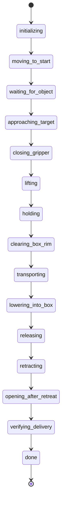

# 01 システム設計とコードの読み方

## 1. 最初の問題から完成形へ

旧デモは静的な対象モデルを手先へ追従させる方式で、見た目の搬送と実際の保持が一致しませんでした。色だけを学習しており、把持動作は学習していませんでした。今回、学習用MuJoCo環境と、力・接触を使うGazebo配送モードを追加しました。旧方式は比較・参照用に残しています。

|段階|役割|主な実装|
|---|---|---|
|学習用モデルの準備|URDFを読み、指の凹形状を凸分割|`physics_grasp/prepare_model.py`, `build_scene.py`|
|把持方策の学習|8変数をCEMで探索、保持の成否を評価|`physics_grasp/experiment.py`|
|Gazeboモデル生成|動的な箱、配送箱、接触センサー、effort設定|`tools/prepare_physical_delivery.py`|
|色の認識|RGB決定木→マスク→輪郭中心|`gazebo_delivery_demo.py`, `learned_color.py`|
|配送制御|接近、把持、運搬、解放、完了確認|`physical_delivery.py`|
|運動学と幾何判定|FK/IK、箱8頂点、指の最低点|`physical_plan.py`|
|滑らかな軌道|速度・加速度を制限する5次補間|`motion_profile.py`|
|検証・保存|試験、失敗終了、集計、提出物生成|`tools/*physical*.py`|

以下、ROSモジュールの場所は`../ros2_ws/src/final_project_ros/final_project_ros/`です。

## 2. データの流れ

```mermaid
flowchart TD
    URDF[CRANE+ URDF] --> MJ[MuJoCo 接触物理モデル]
    MJ --> CEM[CEM 把持方策探索]
    CEM --> POLICY[physics_grasp/results/policy.json]
    POLICY --> PREP[prepare_physical_delivery.py]
    URDF --> PREP
    PREP --> GZ[Gazebo ODE + effort制御]
    GZ --> IMG[上方カメラ画像]
    IMG --> COLOR[RGB決定木・輪郭中心]
    COLOR --> DET[/target_point]
    GZ --> OBS[モデル位置・関節値・接触]
    OBS --> CTRL[physical_delivery.py]
    DET --> CTRL
    CTRL --> IK[physical_plan.py]
    IK --> PROFILE[motion_profile.py]
    PROFILE --> GZ
    CTRL --> EVIDENCE[JSON・動画・画像]
```

画像はピック開始の確認に使い、3次元座標はGazeboから読みます。深度推定、画像からの直接関節制御、実機カメラによる一般的な物体姿勢推定は実装していません。

## 3. 起動経路と生成物

`run_demo.sh`→`run_physical_demo.sh`→環境source→モデル生成→colcon build→`physical_delivery.launch.py`の順です。モデル生成は毎回行うため、生成済みURDFやYAMLを直接編集すると次の起動で戻ります。

生成元：`tools/prepare_physical_delivery.py`。

|生成先（ROSパッケージ内）|内容|
|---|---|
|`worlds/physical_delivery.world`|箱、配送箱、照明、カメラ、接触センサー|
|`config/physical_crane.urdf`|既存CRANE+から生成したeffort版|
|`config/physical_controllers.yaml`|関節軌道制御器とゲイン|
|`config/gripper_collision_vertices.npz`|STLから抽出した指の頂点|
|`config/physical_scene.json`|seed、質量、摩擦、初期位置|
|`models/learned_grasp_policy.json`|MuJoCoの保存済み方策のコピー|

launchはGazeboとrobot_state_publisherを起動し、ロボット生成後にjoint_state→arm→handの順でコントローラを起動します。その後に認識・配送ノードを起動します。配送ノードが終了するとGazeboも終了します。起動シーケンスはプロセス終了イベントでつないでおり、各spawnerの終了コードを厳密に分岐する構成ではありません。起動失敗の調査ではログも確認してください。

通常モードは`DELIVERY_MODE=physical`、旧方式は`legacy`です。物理モードではMoveIt `/compute_ik`を使わず、専用の数値IKを使います。

## 4. ROSトピック

|トピック|型|用途|
|---|---|---|
|`/camera/color/image_raw`|sensor_msgs/Image|上方カメラ→色認識|
|`/target_point`|geometry_msgs/PointStamped|画像のピクセル中心。メートルではない|
|`/gazebo/model_states`|gazebo_msgs/ModelStates|対象位置・姿勢・速度の観測|
|`/joint_states`|sensor_msgs/JointState|実測関節値|
|`/grasp/contacts`|gazebo_msgs/ContactsState|青い箱と両指・配送箱床との接触|
|`/crane_plus_arm_controller/joint_trajectory`|trajectory_msgs/JointTrajectory|4関節の指令|
|`/crane_plus_gripper_controller/joint_trajectory`|同上|手指1関節の指令|
|`/demo_camera/color/image_raw`|sensor_msgs/Image|斜めからの記録用カメラ|
|`/task_state`|std_msgs/String|状態の通知|

制御周期の指定は20ms、接触センサーは100Hz、controller_managerは500Hzです。Pythonノードや描画の処理遅延があるため、指定周期どおりの実測サンプリングは保証されません。

## 5. 座標と寸法

単位はm、rad、s、kg、Nmです。`BASE=[0.1,-0.05,0.05]`はロボット基準のワールド位置です。`object_position()-BASE`で専用運動学の基準へ変換します。ベース姿勢の回転は扱わず、平行移動だけを仮定しています。

|対象|ワールド座標・寸法|
|---|---|
|青い箱の初期中心|`[0.205,-0.025,0.071]`、一辺0.04|
|学習環境内の基準XY|`[0.105,0.025]`（GazeboのBASE差し引き後に対応）|
|テーブル上面|z=0.05|
|配送箱中心XY|`TRAY=[0.075,-0.175]`|
|配送箱の床上面|z=0.06|
|配送箱の壁上端|z=0.095|
|配送箱の内側半幅|0.07|
|赤い箱の初期中心|`[0.31,0.055,0.071]`|

箱は重力で少し沈み、初期中心zは約0.0698で落ち着きます。初期生成位置0.071と、配送開始時の観測値を混同しないでください。

上方カメラは位置`[0.55,0.15,1.4]`、画像640×480、水平画角1.3962634radです。制御側はこの値を直接使って投影します。`fx=fy=640/(2*tan(fov/2))`、`depth=1.4-z`、`u=320-fx*(y-.15)/depth`、`v=240-fy*(x-.55)/depth`です。検出と投影の差18pixel未満で検出時刻を更新し、1秒以内の検出を開始条件にします。カメラを変える場合はワールドと`on_detection()`の両方を更新する必要があります。

## 6. 状態機械



いずれの段階でも例外や判定失敗は`error`へ進み記録を保存します。

|状態|実行内容・次へ進む条件|
|---|---|
|initializing|関節・対象モデル・軌道購読者を待ち、把持計画を計算|
|moving_to_start|開いた指で学習時の持ち上げ姿勢へ移動|
|waiting_for_object|最近1秒以内の画像対応。10秒超で検出失敗|
|approaching_target|学習した補正位置・手首姿勢へ接近|
|closing_gripper|閉じ指令を送り、軌道終了後に両指接触を確認|
|lifting|持ち上げ後、両指接触かつ箱中心がBASEより0.065以上|
|holding|1秒保持。この間も両指接触を確認|
|clearing_box_rim|箱中心を少なくともworld z=0.16へ狙い、手首pitch=2.2で余裕を作る。完了時に箱8頂点の最低z≥0.11|
|transporting|主に第1関節のyawを回す。速度0.5・加速度0.8に制限|
|lowering_into_box|観測した把持オフセットを使い、中心world z=0.105、pitch=2.8へ下降|
|releasing|中心XYの誤差≤0.045を確認し、指を-0.15radまで開く|
|retracting|指の最低点から必要上昇量を計算し、姿勢を保って上昇|
|opening_after_retreat|全開を仮定した指最低点world z≥0.1を確認し、-0.65radへ全開|
|verifying_delivery|1.5秒待った後、箱内位置・床接触・速度・赤い物体を確認|

`ready()`は指令終了後0.25秒以上経ち、4つのアーム関節の最大誤差が0.10rad未満なら通ります。終端時刻+4秒を過ぎても未到達なら停止します。旧制御の連続3サンプル判定とは異なり、物理配送では1回の判定です。指の目標角への到達は要求しません。物体に当たった指が目標より手前で止まることは把持中の正常な状態だからです。

## 7. 把持と運搬を分けて考える

学習した把持は、最初に箱を挟むまでの補正です。配送ではさらに、配送箱の壁を越える高さ、運搬中の保持、解放時の干渉を扱う必要があります。把持単体30/30成功でも配送完成にはならなかったのは、この追加条件があったためです。

運搬の計画は、実測した箱位置と手首姿勢から`offset=R.T@(box-BASE-wrist)`を計算します。配置IKでは予測箱位置`wrist(q)+R(q)@offset`が配送目標へ来るように解きます。このオフセットは**到達目標の計算だけ**に使います。物理エンジン内の箱の位置を書き換えたり、固定拘束で貼り付けたりはしません。滑り・変形・把持のずれを完全に補償する制御でもありません。

## 8. 接触判定と完了判定の正確な意味

両指の接触は、それぞれ最後に検出した時刻が現在から0.2秒以内かで判断します。2つの接触が同一物理ステップで存在することや、最小の接触力を満たすことは要求していません。ノイズに対する猶予を与える一方、短い離脱を見逃す余地があります。

運搬中の落下判定は箱中心world z<0.105、または開始0.3秒後以降に両指接触が失われることです。箱の8頂点の縁クリアランスは運搬**開始前**に確認し、運搬中に毎回再確認してはいません。

最終判定は次の条件です。

- 箱の8頂点のXY範囲が配送箱中心±0.071以内（内側半幅0.07に1mmの許容）。
- 箱底面の最低zが0.057より大きく0.063未満、最高zが0.115未満。
- 並進速度<0.02m/s、角速度≤0.1rad/s。
- 配送箱床との接触履歴が0.2秒以内。
- `bilateral()`がfalse、赤い物体の開始時からの3次元変位≤0.005m。

「両指で保持していない」判定であって、「どちらの指にも一切触れていない」ことを直接要求するコードではありません。退避形状確認との組み合わせで分離を狙っています。また1.5秒間ずっと安定したことを統計するのではなく、待機後の1回の判定です。

## 9. 指令の連続性

区間の始点を毎回実測角にすると、把持で物体に阻まれた指の位置まで指令が戻り、保持トルクを生む誤差が消えます。現在は、初回以外はアームを`self.goal`、指を`self.hand_setpoint`から補間します。実測値は到達確認と運動学へ使い、指令の継ぎ目は前の目標に接続します。

これは大きな追従誤差がある状態でも無条件に続ける設計ではありません。`ready()`の誤差制限で停止させます。ただし指令の連続性は、実測速度・トルクの連続性そのものを保証しません。

## 10. 今後の実装時に守りたい境界

- 実際の接触把持を評価する間は、対象位置の強制更新や固定拘束を導入しない。
- 関節の到達と、対象を保持できたことを別に判定する。
- 学習用のモデル、Gazebo用のモデル、成功条件、使用した方策を一緒に記録する。
- `error`はシミュレーション上の停止・終了です。実機の保護停止や非常停止として使えるものではありません。
- ソースの物理設定を変えた場合は、学習方策も別条件で得たものとして扱う。
